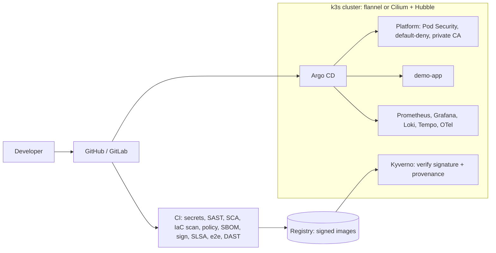

# enterprise-devsecops-lab

A reproducible, production-shaped DevSecOps platform: k3s on Terraform-provisioned nodes,
hardened with Ansible, delivered with Argo CD, secured with a signed and verified software
supply chain, observed with Prometheus, Loki, Tempo and OpenTelemetry, with cloud variants
for AWS EKS and Azure AKS.

> **Independent reconstruction.** This project is an independently reconstructed lab based on
> general engineering patterns I have used professionally. It contains no employer source
> code, configurations, credentials, network information, customer information, or
> proprietary material. Commercial security products used in the professional environment
> are replaced with open-source equivalents ([ADR 0003](docs/adr/0003-open-source-replacements-for-commercial-tools.md)).



## Quickstart

Docker, Terraform, kubectl, Go and GNU make (Git Bash on Windows). Everything else runs
from pinned container images.

```bash
make up              # 3-node k3s in Docker, image build + import, platform, demo-app (~5 min)
make e2e             # 14 end-to-end security and behaviour checks
make observability   # metrics, logs and traces, verified end to end
make dast            # OWASP ZAP baseline + Nuclei
make argocd          # Argo CD tracking this repository (after it is pushed to GitHub)
make argocd-verify   # every app Synced/Healthy, self-heal restores a deleted object
make scan            # every linter and scanner the pipeline runs
make molecule        # Molecule test of the Ansible hardening role
make down
```

Variants: `make up CNI=cilium ...` for Cilium + Hubble ([deployment.md](docs/deployment.md)),
Terraform + Ansible on Proxmox VMs, and EKS/AKS modules ([cloud.md](docs/cloud.md)).

## Capability map: claim → evidence

| Capability | Where to look | How it is proven |
|---|---|---|
| Kubernetes platform (k3s) | [terraform/modules/k3s-docker-cluster](terraform/modules/k3s-docker-cluster), [ansible/roles/k3s](ansible/roles/k3s) | 3 nodes Ready in CI; control plane tainted; secrets encryption on |
| Infrastructure as Code | [terraform/](terraform) (Docker, Proxmox, AWS, Azure) | `validate`, tflint, Checkov, Trivy on every change |
| Configuration management | [ansible/](ansible) | ansible-lint production profile; Molecule converge, idempotence and verify for `linux-hardening` |
| Helm chart authoring | [kubernetes/helm/demo-app](kubernetes/helm/demo-app), [observability-stack](kubernetes/helm/observability-stack) (umbrella) | `helm lint --strict`, kubeconform, conftest, Checkov on rendered output |
| GitOps | [kubernetes/argocd](kubernetes/argocd) | App-of-apps with platform/workload AppProjects; `make argocd-verify` checks Synced/Healthy and self-heal |
| CI/CD | [.github/workflows](.github/workflows), [.gitlab-ci.yml](.gitlab-ci.yml) | Same `scripts/` on both; GitLab file validated by a real GitLab instance ([gitlab/](gitlab)) |
| Secure SDLC | [scripts/scan.sh](scripts/scan.sh) | gitleaks, Semgrep, gosec, govulncheck, Trivy, Checkov, conftest, hadolint, ZAP, Nuclei |
| Supply-chain security | [ci.yml](.github/workflows/ci.yml), [verify-images.yaml](kubernetes/supply-chain/verify-images.yaml) | Syft SBOM, cosign keyless signing, SLSA provenance, Kyverno admission verification, offline policy tests |
| Network security | [kubernetes/platform](kubernetes/platform), [network-design.md](docs/network-design.md) | e2e: unlisted namespace blocked, allowed namespace succeeds (positive control); Hubble shows `Policy denied` |
| eBPF / Cilium | [kubernetes/cilium](kubernetes/cilium), [scripts/cilium.sh](scripts/cilium.sh) | Same e2e suite passes on Cilium; Hubble drop observed for a blocked probe |
| Observability | [observability-stack](kubernetes/helm/observability-stack), [app/](app) | Prometheus scrapes, Loki has logs, Tempo has traces, SLO alert rules loaded |
| IAM, OIDC, secrets, KMS | [aws-eks](terraform/modules/aws-eks), [azure-aks](terraform/modules/azure-aks), [github-oidc-*](terraform/modules) | Pod Identity / Workload Identity, KMS envelope encryption, OIDC CI roles; Checkov clean with documented skips |
| Threat modelling | [docs/threat-model.md](docs/threat-model.md) | STRIDE per trust boundary; control IDs shared with the Rego rules |
| EU regulation | [compliance/eu-regulatory-mapping.md](compliance/eu-regulatory-mapping.md) | CRA Annex I, NIS2 Art. 21, DORA mapped to evidence, with gaps stated |
| FinOps | [docs/cloud.md](docs/cloud.md) | Spot pools, single NAT in dev, S3 endpoint, log ingestion caps, mandatory cost tags |

## Verification results (local run)

| Check | Result |
|---|---|
| End-to-end suite (flannel and Cilium clusters) | 14 / 14 pass on each |
| Observability verification | 4 / 4 (metrics, logs, traces, alert rules) |
| GitOps | 4 apps Synced/Healthy; a NetworkPolicy deleted by hand was restored by self-heal |
| Cilium | 3 agents healthy, Hubble recorded the policy drop |
| OWASP ZAP baseline | 0 FAIL, 60 rules passed |
| Nuclei | 0 medium+ findings after fixing one it found |
| Policy tests | 7 Rego unit tests, 3 Kyverno tests |
| Molecule (`linux-hardening`) | converge, idempotence (0 changed), verify all pass |
| Checkov | 0 failed on Kubernetes, Docker, Terraform (local, AWS, Azure) |

Real failures and fixes found along the way are kept in [docs/troubleshooting.md](docs/troubleshooting.md).
Two were security findings: Nuclei found `/metrics` exposed through the ingress, and Molecule
found a first-boot bug in the SSH hardening role.

## Case studies

Engineering write-ups of the professional work this lab reconstructs, without confidential detail:

1. [On-premises Kubernetes platform](case-studies/01-on-prem-k3s-platform.md)
2. [Self-hosted DevSecOps platform](case-studies/02-self-hosted-devsecops-platform.md)
3. [Enterprise security infrastructure](case-studies/03-enterprise-security-infrastructure.md)

## Security

See [SECURITY.md](SECURITY.md) for vulnerability reporting.

## 中文摘要

這是一個可重現、以生產環境為藍本的 DevSecOps 平台實驗室：以 Terraform 建立 k3s 叢集（Docker、Proxmox VM，並提供 AWS EKS / Azure AKS 雲端版本）、Ansible 主機強化、Argo CD GitOps 交付、簽章與驗證的軟體供應鏈（SBOM、cosign、SLSA provenance、Kyverno admission 驗簽），以及 Prometheus / Loki / Tempo / OpenTelemetry 全端可觀測性，CNI 可切換為 Cilium + Hubble。

本專案為依據我在工作中使用過的一般工程模式「獨立重建」的實驗環境，不包含任何雇主程式碼、設定、憑證、網路資訊、客戶資料或專有資料；商業資安產品以開源工具替代。每一項能力都附上可執行的驗證（e2e、政策測試、Molecule、DAST），結果見上方「Verification results」。
