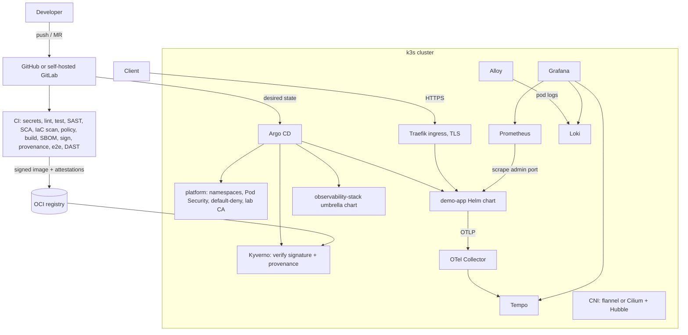

# Architecture

The lab is a small platform built the way an on-premises enterprise platform is built:
infrastructure as code, a hardened Kubernetes distribution, GitOps delivery, a secure
software supply chain and full-stack observability. The same design has three runtimes.

| Runtime | Where | Provisioned by | Purpose |
|---|---|---|---|
| `local` | Docker on a laptop or CI runner | Terraform (`kreuzwerker/docker`) | Reproducible by anyone in about 5 minutes; runs in CI on every main build |
| `proxmox` | VMs on a Proxmox host | Terraform (`bpg/proxmox`) + Ansible | The production-shaped variant: real VMs, real kernels, VLANs |
| `aws-dev` / `azure-dev` | EKS / AKS | Terraform | Cloud variants of the same platform; validated and scanned, planned via OIDC, not applied |

## Component view

## Design principles

1. **Everything is code, everything is reviewed.** Clusters, VMs, cloud networks, host
   hardening, Kubernetes manifests, policies and pipelines all live in this repository.
2. **Prove controls, don't just declare them.** Every important control has a test that
   would fail if the control broke. NetworkPolicy has a positive control, Pod Security has
   a rejection test, the TLS issuer is checked, and GitOps self-heal is exercised.
3. **Secure by default, exceptions on record.** Workloads run non-root, read-only,
   capability-free, with default-deny networking. Every deviation is a row in
   [accepted-risks.md](../security/scanning/accepted-risks.md) with an owner and a review trigger.
4. **No long-lived credentials.** CI reaches the clouds through OIDC federation, workloads
   use EKS Pod Identity or AKS Workload Identity, and nodes cannot reach instance metadata.
5. **Pin and verify the supply chain.** Tool images, charts, providers and binaries are
   pinned; images are signed with SLSA provenance and verified at admission.

## Request path

1. A client resolves `demo.lab.example` and connects to Traefik on a node (loopback port 8443
   in the local runtime).
2. Traefik terminates TLS with a certificate issued by the lab CA (cert-manager) and forwards
   every path to the demo-app **public listener** (port 8080).
3. The public listener serves only `/api/*`. Unknown paths return a 404 that still carries
   the security headers (HSTS, CSP, frame and content-type protection).
4. Probes and `/metrics` live on the **admin listener** (port 9090). The ingress never routes
   it, and NetworkPolicy opens it only to the `monitoring` namespace. This split came from a
   Nuclei finding during DAST: `/metrics` was reachable through the ingress.
5. Each request emits a trace to the OTel Collector, which forwards to Tempo. Logs are JSON
   on stdout and reach Loki through Alloy. Prometheus scrapes the admin port.

## Repository map

| Path | Contents |
|---|---|
| `app/` | Demo Go service, distroless image, unit tests |
| `terraform/modules/` | `k3s-docker-cluster`, `proxmox-vm`, `aws-eks`, `azure-aks`, `github-oidc-aws`, `github-oidc-azure` |
| `terraform/environments/` | `local`, `proxmox`, `aws-dev`, `azure-dev` |
| `ansible/` | Roles `linux-hardening` (Molecule-tested), `k3s`, `gitlab-runner`, `node-exporter`; `playbooks/site.yml` |
| `kubernetes/helm/` | `demo-app` chart and `observability-stack` umbrella chart |
| `kubernetes/platform/` | Kustomize base/overlays: namespaces, Pod Security, default-deny, lab CA |
| `kubernetes/argocd/` | Projects, app-of-apps, one Application per component |
| `kubernetes/cilium/`, `kubernetes/supply-chain/` | Cilium/Hubble values, Kyverno policies and offline policy tests |
| `security/` | Rego policies and tests, scanner config, accepted risks, DAST rules |
| `scripts/` | Every pipeline step as a script, so laptop, GitHub and GitLab run identical commands |
| `compliance/` | CRA / NIS2 / DORA mapping with gap status |
| `case-studies/` | Three NDA-safe engineering case studies |
