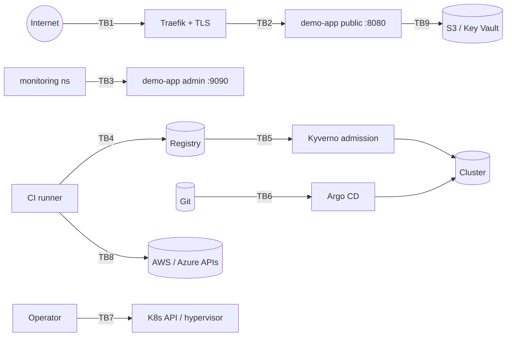

# Threat model

Method: data-flow diagram, trust boundaries, STRIDE per boundary. Every mitigation names how
it is enforced and how it is verified. A control without a verification is marked as such.
Control IDs (`TM-*`) are the same IDs used in [security/policy/kubernetes.rego](../security/policy/kubernetes.rego).

## Assets

| Asset | Why it matters |
|---|---|
| Container images and their provenance | Whatever runs in the cluster is whatever the registry serves |
| Git repository (desired state) | Argo CD makes the cluster match it |
| Cluster credentials, CI identities, cloud roles | Control over everything above |
| Kubernetes Secrets, KMS keys | Envelope keys for every stored secret |
| Telemetry (logs, traces, metrics) | Evidence for detection and incident response |

## Trust boundaries

## STRIDE per boundary

### TB1 Internet → ingress

| Threat | Mitigation | Enforced by | Verified by |
|---|---|---|---|
| S: spoofed server | TLS with a CA-issued certificate | cert-manager, `TM-NET-01` (Ingress must have TLS) | e2e: certificate issuer check |
| T: downgrade / sniffing | HTTPS only, HSTS | App header, Traefik TLS | e2e header check, ZAP rule 10035 = FAIL |
| I: information disclosure by internal endpoints | Admin port never routed | Chart: ingress → public port only | e2e: `/metrics`, `/healthz`, `/readyz` return 404; Nuclei |
| D: request flood | HPA, resource limits | Chart | 🔶 No ingress rate limit yet |

### TB2 Ingress → app, and pod-to-pod

| Threat | Mitigation | Enforced by | Verified by |
|---|---|---|---|
| E: lateral movement from a compromised pod | Default-deny, per-workload allow-lists | NetworkPolicy (flannel + kube-router, or Cilium) | e2e: unlisted namespace blocked, monitoring allowed (positive control); Hubble shows `Policy denied` |
| E: container breakout | Non-root, no privilege escalation, drop ALL, seccomp, read-only rootfs | `TM-K8S-01..03`, `TM-K8S-07`, PSA `restricted` | conftest in CI; e2e: privileged pod rejected |
| D: noisy neighbour | Requests/limits | `TM-K8S-04` | conftest |
| E: host access | No hostNetwork/hostPID/hostIPC | `TM-K8S-05` | conftest |
| I: token theft | No service-account token mounted | `TM-K8S-06` | conftest (warn) |

### TB3 Monitoring → admin port

| Threat | Mitigation | Enforced by | Verified by |
|---|---|---|---|
| I: metrics scraped by anyone | Admin port reachable from `monitoring` only | NetworkPolicy | e2e positive and negative probes |

### TB4 CI → registry, and TB5 registry → cluster

| Threat | Mitigation | Enforced by | Verified by |
|---|---|---|---|
| T: tampered image | Keyless cosign signature by the CI workflow identity | CI `sign` step, Kyverno `verifyImages` | CI `cosign verify` |
| T: image built from an unreviewed branch or another repo | SLSA provenance, admission checks repo and `refs/heads/main` | `attest-build-provenance`, Kyverno attestation conditions | CI `cosign verify-attestation` |
| T: mutable tag swapped | Digest pinning; content-derived local tags | Kyverno `mutateDigest`/`verifyDigest`, `TM-SUP-01/02` | conftest; local build tags |
| E: untrusted registry | Registry allow-list | Kyverno `restrict-image-registries` | `kyverno test` (offline) |
| I: vulnerable dependency shipped | Scan gates and SBOM | Trivy, govulncheck, Syft | CI fails on fixable HIGH/CRITICAL |

### TB6 Git → Argo CD

| Threat | Mitigation | Enforced by | Verified by |
|---|---|---|---|
| T: drift / manual change in the cluster | Self-heal | Argo CD `selfHeal: true` | `argocd-verify.sh` deletes a managed NetworkPolicy and expects it back |
| E: an Application deploying outside its lane | AppProjects restrict repos, namespaces and cluster-scoped kinds | `lab` and `platform` projects | Manifest review; Argo CD refuses out-of-project resources |
| S: rogue Git source | Source repo allow-list in each project; private repo with credentials | AppProject `sourceRepos`, repository Secret | Manifest review |

### TB7 Operator → Kubernetes API and hypervisor

| Threat | Mitigation | Enforced by | Verified by |
|---|---|---|---|
| R: unattributed changes | API audit policy (Metadata for secrets, RequestResponse for RBAC/NetworkPolicy) | Ansible `k3s` role, EKS control-plane logs | 🔶 Manual review |
| S: stolen admin kubeconfig | No local accounts on AKS (Entra ID only), EKS access entries, kubeconfig mode 0600 | Terraform | `terraform validate`, Checkov |
| E: SSH brute force | Keys only, AllowGroups, MaxAuthTries 3, nftables default drop | Ansible `linux-hardening` | Molecule verify asserts effective `sshd -T` |

### TB8 CI → cloud APIs, and TB9 workload → cloud services

| Threat | Mitigation | Enforced by | Verified by |
|---|---|---|---|
| S/I: leaked long-lived cloud keys | No stored keys: GitHub OIDC federation | `github-oidc-aws`, `github-oidc-azure` | Workflow uses `id-token: write` only |
| E: PR pipeline gets write access | Plan role read-only; apply role only from a protected environment | Trust-policy `sub` conditions | Manifest review |
| E: pod uses the node's cloud role | IMDSv2 hop limit 1; Pod Identity / Workload Identity per service account | Launch template, federated credentials | Checkov |
| I: secrets readable from etcd | KMS envelope encryption with rotation | EKS `encryption_config`, AKS `key_management_service` | Checkov |

## Residual risks

Tracked with owner and review trigger in [accepted-risks.md](../security/scanning/accepted-risks.md).
Organisational gaps (incident reporting, backup drills) are in
[compliance/eu-regulatory-mapping.md](../compliance/eu-regulatory-mapping.md#4-gap-summary-and-next-steps).
